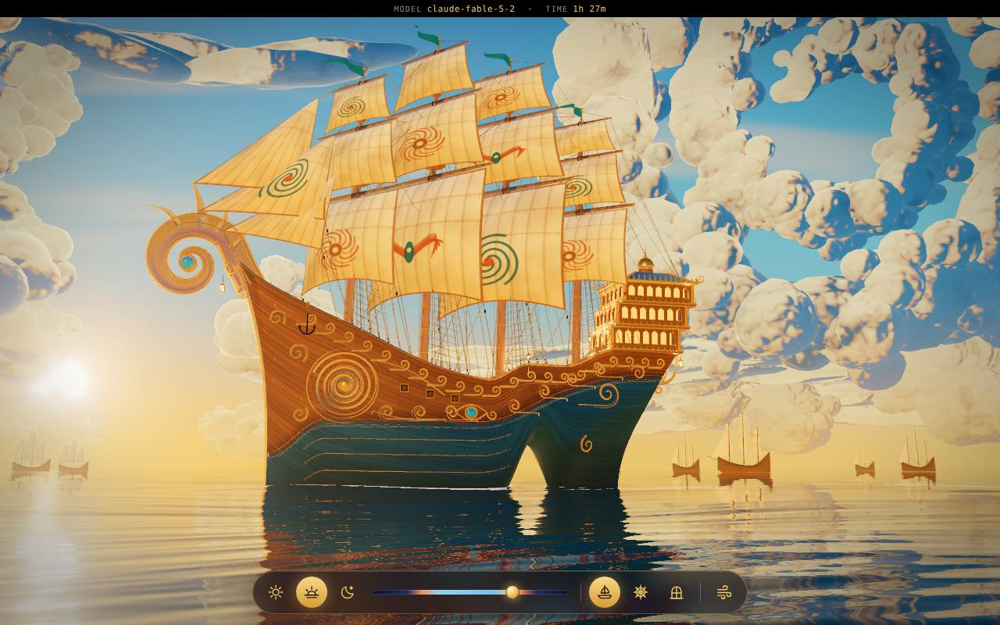
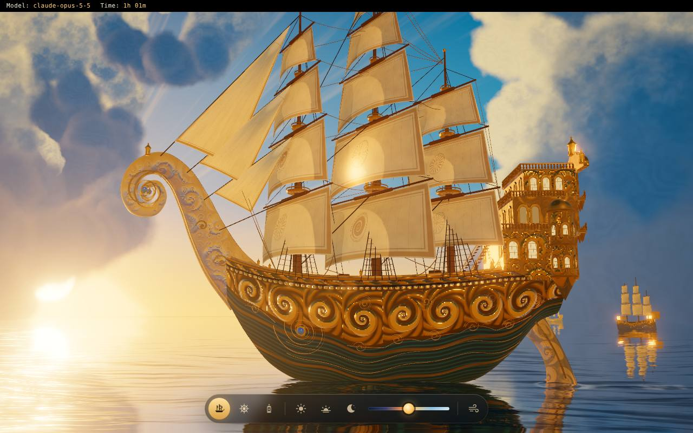
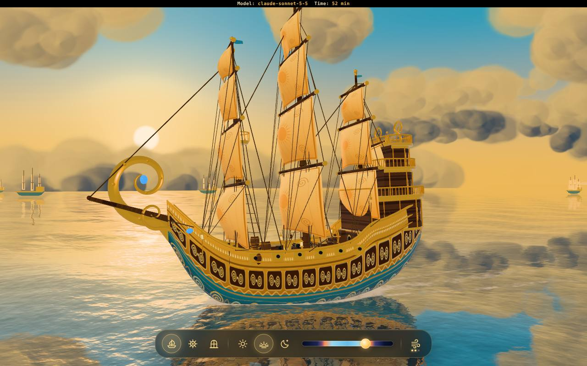
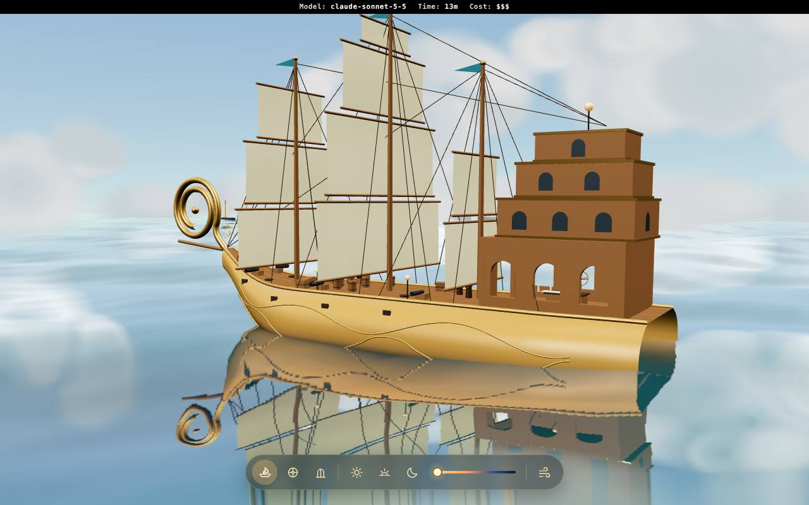

# Claude Battle: Auric Voyage

[](https://eval-forge.github.io/claude-battle/)
[](https://eval-forge.github.io)


Fable 5.2, Opus 5.5, Sonnet 5.5 and Haiku 5.5, all on `high` effort, all given the same prompt and the same reference image: build **Auric Voyage**, an ornate golden fantasy sailing ship in Three.js, as one standalone HTML file.

| | | | |
|:---:|:---:|:---:|:---:|
| [](https://eval-forge.github.io/claude-battle/fable-5-2.html) | [](https://eval-forge.github.io/claude-battle/opus-5-5.html) | [](https://eval-forge.github.io/claude-battle/sonnet-5-5.html) | [](https://eval-forge.github.io/claude-battle/haiku-5-5.html) |
| **#1 Fable 5.2** | **#2 Opus 5.5** | **#3 Sonnet 5.5** | **#4 Haiku 5.5** |

## Results

| Rank | Model | Score (S) | Truthness to prompt (P) | Time | Time score (T) | Final |
|:---:|:---|:---:|:---:|:---:|:---:|:---:|
| 1 | [Fable 5.2](fable-5-2.html)  | 92 | 95 | 1h 27m | 0.0 | **92.4** |
| 2 | [Opus 5.5](opus-5-5.html)  | 78 | 90 | 1h 01m | 35.1 | **81.3** |
| 3 | [Sonnet 5.5](sonnet-5-5.html)  | 67 | 100 | 52m | 47.3 | **76.6** |
| 4 | [Haiku 5.5](haiku-5-5.html)  | 12 | 80 | 13m | 100.0 | **32.5** |

## The formula

```
Final = 0.70 * S + 0.295 * P + 0.005 * T

T = 100 * (t_max - t) / (t_max - t_min)        t_min = 13 min, t_max = 87 min
```

- **S**: score, 0 to 100. Overall quality of the scene.
- **P**: truthness to prompt, 0 to 100. How much of what the prompt asked for is there and working.
- **T**: time score, 0 to 100. Fastest entry gets 100, slowest gets 0.

Weights are 70% score, 29.5% truthness, 0.5% time. Being the fastest is worth half a point, so time only ever breaks a near tie.

## Files

| File | What it is |
|:---|:---|
| `index.html` | The results page: ranking, formula, live previews, charts and the full prompt |
| `fable-5-2.html`, `opus-5-5.html`, `sonnet-5-5.html`, `haiku-5-5.html` | The four entries, exactly as each model delivered them |
| `previews/` | Screenshots used on the results page and above |
| `fable-5-2-torus-knot.html` | Bonus: a shimmering torus knot, not part of the battle |

Open `index.html` locally or visit the live site. The scores, times and weights live in one `ENTRIES` array and one `W` object at the bottom of `index.html`, so adding a model is a one-line job.
